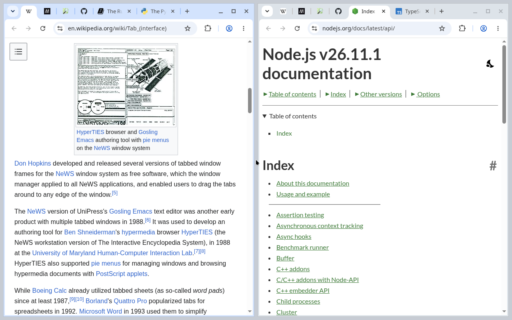

# Zen Essentials in Chrome

A Chrome extension that brings the tab handling of the Zen browser to Chromium-based browsers: the same pinned tabs in every window, like Zen's Essentials, a new tab overlay that opens no tab until you pick where to go, and a toolbar button that clears away the other tabs.



## Install

From the [Chrome Web Store](https://chromewebstore.google.com/detail/ofcghgcepialnjkeghndofphhdaokdeg), or from the [Releases](https://github.com/nanbiz/synced-pins/releases) page: unzip `synced-pins-<version>.zip`, open `chrome://extensions`, turn on Developer mode, click **Load unpacked** and pick the unzipped folder. It is built for Chromium-based browsers and tested in Chrome, Chromium, Brave, Edge, Vivaldi and Helium.

## Pinned tabs in every window

Each pinned tab is open in one window. Your other windows show it in the same place, with its icon, and selecting it there brings the page over as it is: nothing reloads, a video keeps playing, a half-typed message stays. Switching to a window that shows a pinned tab brings the page back there too. A window showing one of its own tabs takes nothing, so a pinned tab can keep running in one window while you work in another.

- Pin a tab in any window and it shows up pinned in all of them. Reordering pinned tabs works the same way from any window.
- Unpin a pinned tab in any window to remove it from all of them. Unpinning one that shows a stand-in brings its page into that window as an ordinary tab.
- Closing a pinned tab closes its page, but the pin stays, as Zen does with Essentials: every window keeps showing it, and the next time you select it, it opens at the address it was pinned at. Reopening the closed tab right away (Ctrl+Shift+T) brings the page back. Chromium closes a pinned tab on the second Ctrl+W.
- Putting a pinned tab into a tab group unpins it in Chromium, as when an extension like Claude groups the tab it works in. The page goes with the group as an ordinary tab, and the pin stays as if its tab had been closed. Pinning that tab again makes it the pin's tab once more.
- In a window where a pinned tab is not open, its place holds a stand-in page with the tab's icon and title. That is what a window shows when the tab it was showing is pulled into another window.
- Close the window a pinned tab is open in and the tab opens again in the window you used last, at the same address.
- Pinned tabs stay across a browser restart or crash. Any the browser does not bring back open again in the window you used last, in the same order. If the browser restores its old session afterwards, its tab takes the place of the reopened one, as long as you have not selected that one yet.
- Popups, installed web apps and incognito windows are left alone.

## New tab overlay

Press **Ctrl+Shift+Space** and a search bar opens in the middle of the page instead of a new tab. Nothing is opened until you pick something:

- With nothing typed it lists your pinned tabs.
- A tab opened with the tab strip's **+** or the menu, on the New Tab page, becomes the overlay too; Escape closes it and goes back to the tab you were on. Once you click **Allow** on its *Open over the page instead of a tab* row, the New Tab page closes at once and the overlay opens over the page you were on.
- Type an address or a search and press Enter to open it in a new tab. The search goes to your browser's default search engine.
- Type part of a tab's title or address to switch to that tab, in any window. Picking a pinned tab brings its page into the window you are in.
- Once you click **Include** on the overlay's *History and bookmarks* row and allow it, a site you have visited whose name starts with what you type comes first (*y* offers youtube.com), and visited pages and bookmarks follow the open tabs.
- Type the name of an action, such as *pin tab*, *close tab*, *duplicate*, *reload*, *copy current url*, *next tab*, *private window*, *print* or *settings*, to run it on the tab under the overlay.
- Escape or a click beside the bar closes it. Text you typed comes back if you open it again over the same tab within 45 seconds.

On pages a browser keeps extensions out of, such as its settings, the New Tab page or the Web Store, the overlay opens below the toolbar button instead; Vivaldi, which opens no extension popups on request, gets it as a tab of its own.

### Putting it on Ctrl+T

Browsers keep Ctrl+T for themselves: an extension cannot ask for it, and the shortcuts page at `chrome://extensions/shortcuts` cannot record it. It can still be set once by hand. While it is not set, the overlay shows **Set up** at its foot, which opens a page with a **Use Ctrl+T** button that copies the line below and opens `chrome://extensions`; there, press F12, open **Console**, paste and press Enter:

```js
chrome.developerPrivate.updateExtensionCommand({ extensionId: 'ofcghgcepialnjkeghndofphhdaokdeg', commandName: 'open-overlay', keybinding: 'Ctrl+T' })
```

From then on Ctrl+T opens the overlay and no new tab. A copy loaded unpacked has its own id, which `chrome://extensions` shows on its card.

## Clearing tabs

The toolbar button closes every tab of its window that is neither pinned nor in a tab group, apart from the one you are on, and its badge shows how many that is. Click it once more and the overlay opens over the tab you are on, which goes for whatever you pick there: an address or search loads in its place, and switching to another tab or pin closes it. Escape keeps it. On a page the overlay cannot be drawn over, the overlay takes the tab's place at once. Pinned tabs and tab groups always stay.

## Permissions

- `tabs` lets the extension read the address, title and icon of your tabs: of pinned ones to draw them in your other windows, and of open ones to suggest them in the overlay. Chrome describes this permission as "Read your browsing history".
- `storage` keeps the list of pinned tabs while the browser runs and across restarts.
- `favicon` lets the stand-in pages take a pinned site's icon from the browser's own store of site icons where the site lets only its own pages load it. Chrome describes it as "Read the icons of the websites you visit".
- `activeTab` and `scripting` let the overlay be drawn over the page you are on, only after you press its shortcut there.
- `search` sends a search you pick in the overlay to your browser's default search engine.

`activeTab`, `scripting` and `search` add no warning when installing. Nothing is sent anywhere; see [PRIVACY.md](PRIVACY.md).

## Develop

There are no dependencies. The tests launch a real Chromium with the extension loaded, on a private Xvfb display, and drive it over the DevTools protocol:

```
sh scripts/test-e2e.sh                     # needs chromium and xvfb-run on PATH
CHROME_PATH=/path/to/browser sh scripts/test-e2e.sh
node scripts/package.js                    # dist/synced-pins-<version>.zip
```

Headless Chromium fires no focus events, which is why the suite runs headed.

## License

MIT
